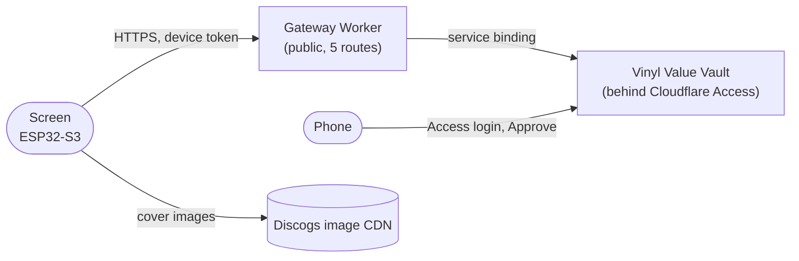

<div align="center">

# Vinyl Vault Screen

**A 4" touchscreen next to the turntable that browses my record collection.**

[](https://github.com/JakubMini/vinyl-vault-screen/actions/workflows/ci.yml)


</div>

A physical front end for [Vinyl Value Vault](https://github.com/JakubMini/vinyl-value-vault), which
holds my 163 records and what each is worth. Swipe through the covers on a "ferris wheel", tap
one to see its price and how it has moved, and grade the record and its sleeve with your thumb.
The price at every grade is right there on the buttons.

> [!NOTE]
> **Working on my desk since 16 October 2026**, against the vault running on my laptop. The
> vault's side of the login is in [vinyl-value-vault#40](https://github.com/JakubMini/vinyl-value-vault/pull/40)
> and the gateway isn't deployed yet. Moved to a Waveshare board on 30 October 2026. A PN532 reader
> sees tags; nothing uses them yet.

## What it does

- **Logs in like a TV app.** The screen shows a QR code and a code. Scan it, log in to the vault
  on your phone, tap Approve. No password or key is ever typed into, or flashed onto, the board.
- **Joins Wi-Fi from the screen.** It scans, you pick a network and type the password on an
  on-screen keyboard. It remembers it, so a restart reconnects on its own.
- **Browses on a wheel.** Covers ride the rim of a big wheel: the one in front is largest, the
  ones before and after shrink and fade round the rim. Drag it, fling it, tap a side cover to
  step to it. It wraps round, so the last record sits before the first.
- **Shows the money.** Current value, change over 30 days, a price history line, and the price
  at each grade from M to P.
- **Grades by touch.** A new grade is saved to the vault straight away, and the record is
  re-priced there at its new grade.
- **Works offline.** Everything it shows is a copy kept on the board, refreshed once an hour (on
  the hour) or when you tap Refresh. Browsing never waits for the network.
- **Becomes a clock when left alone.** After two minutes without a touch, the crate or record
  page turns into an analog clock drawn on the record, with UK time and the date under it. A tap
  goes back to the same record.

## How it works



**Why a gateway.** Cloudflare Access protects the vault on every hostname and path, so a
microcontroller can't reach it. The [Alexa skill](https://github.com/JakubMini/vinyl-vault-alexa)
already solves this with a service binding: one Worker calling another inside Cloudflare. The
gateway does the same, but it forwards only five routes (`POST /api/device/code` and `/token`,
`GET /api/records`, `GET /api/records/:id`, `PATCH /api/records/:id`). It passes on only screen
tokens, so the vault's API key can't be used to get round Access. The vault checks every
token itself, and a screen's token can read records and change grades, nothing more.

**The login** follows the shape of OAuth's device flow (RFC 8628):

1. The screen asks the vault for a code, through the gateway.
2. It shows a QR code for `vault.jakubszypicyn.com/link?code=…`.
3. You open that on your phone, Access asks you to log in, and you tap Approve.
4. The screen has been polling every five seconds; now it gets a token. Only the token's hash is
   stored in the vault, and you can revoke it on the same page.

**Covers.** Discogs serves most covers as *progressive* JPEGs, which the fast decoders for this
chip can't read. So when a cover is new or has changed, the board decodes it once with
[stb_image](https://github.com/nothings/stb) (about a second), shrinks it to 180 px and saves it as
a small *baseline* JPEG, about 15 KB. At start-up all of them, about 2 MB, are loaded into PSRAM.
From there one decodes in a few milliseconds.

**The wheel draws itself.** LVGL draws everything else, but scaling covers in software from PSRAM
ran at 5–7 frames a second. The wheel is drawn by hand instead:

- Each band of rows is built in internal RAM, nearest cover first, so every pixel is drawn once.
- Covers hidden behind a nearer one are skipped.
- Only the columns that changed are copied to the panel.

It runs at about 35 frames a second while spinning (30–42 depending on the build).

**The look** follows the [vinyls page](https://jakubszypicyn.com/vinyls) of the personal site:
its colours, type and record. The records and tonearm are drawn once at boot into PSRAM and never
move, so they cost the wheel nothing (37 frames a second before and after).

**What made it slow, and what fixed it.** The details are in the commit history. Each step came
from a profile taken while the wheel spins itself (`-DWHEEL_BENCH`):

| Step | Frames a second |
| --- | ---: |
| LVGL scaling the covers | 5–7 |
| Drawn by hand, in strips | 20 |
| Covers 25% smaller, copy with `memcpy` | 26 |
| Panel's interrupt moved to the other core, text redrawn less | 30 |
| `-O2`, background filled by rows, text only when the wheel slows | 34–42 |

The chip shares one memory bus between flash, PSRAM and the panel, which reads the frame out of
PSRAM about 40 times a second. That bus is now the limit.

**Keeping the display clean.** Writing to flash pauses that bus, which shows as streaks on the
panel. So the board writes only what changed, all the price histories go in one file, and nothing
touches flash while you browse.

## Hardware

| Part | |
| --- | --- |
| Board | Waveshare **ESP32-S3-Touch-LCD-4B**: ESP32-S3 (16 MB flash, 8 MB PSRAM), 4" 480×480 IPS (ST7701), GT911 touch. The panel's set-up lines and resets go through a TCA9554 IO expander |
| Power | USB-C |
| NFC | PN532 on the H3 header, set to UART: its VCC on pin 4 (3.3 V), GND on 20, TXD on 5 (GPIO43), RXD on 13 (IO0). It reports tags; NTAG215 stickers in the sleeves are next |

The pins and panel set-up are in [`firmware/src/board.cpp`](firmware/src/board.cpp).

## Stack

| Part | Choice | Why |
| --- | --- | --- |
| Firmware | PlatformIO, Arduino core 3 ([pioarduino](https://github.com/pioarduino/platform-espressif32)) | Core 3 (ESP-IDF 5) has bounce buffers for the RGB panel, which keep it steady while Wi-Fi is busy. |
| UI | [LVGL 9](https://lvgl.io) | Screens, text, keyboard, QR code, chart. The wheel is drawn by hand (see above). |
| Display | [Arduino_GFX](https://github.com/moononournation/Arduino_GFX) | Ships this board's panel init sequence. |
| Images | stb_image once, then [JPEGDEC](https://github.com/bitbank2/JPEGDEC) | Progressive originals once; fast baseline copies every time after. |
| Storage | LittleFS (10 MB) + NVS | The collection and covers; Wi-Fi and the token. |
| Fonts | [Funnel Sans and Display](https://fonts.google.com/specimen/Funnel+Sans), [JetBrains Mono](https://github.com/JetBrains/JetBrainsMono), [Noto Sans Devanagari](https://fonts.google.com/noto/specimen/Noto+Sans+Devanagari) (SIL OFL), via `firmware/tools/fonts.sh` | The type of [jakubszypicyn.com](https://jakubszypicyn.com/vinyls). Latin with Polish and the rest of Extended-A, and Devanagari for titles, drawn letter by letter: LVGL doesn't join conjuncts. |
| Gateway | Cloudflare Worker, TypeScript, no framework | 30 lines. Free. Same account as the vault. |

## Run it

**Gateway** (Node 24+):

```bash
cd gateway && npm install && npm run check
```

Run it next to the vault's dev server, both on this laptop, then point the screen at it:

```bash
npm run dev
```

**Firmware** ([PlatformIO](https://platformio.org) Core 6.2+), with the board on USB:

```bash
cd firmware && pio test -e native
```

```bash
pio run -e screen -t upload -t monitor
```

To use a gateway on your laptop instead of the deployed one:

```bash
PLATFORMIO_BUILD_FLAGS='-DGATEWAY_URL=\"http://192.168.0.159:8787\"' pio run -e screen -t upload
```

On first boot: pick Wi-Fi, scan the QR code, approve on your phone. The first sync takes about
five minutes, mostly making the covers. After that it starts in a few seconds.

## How work is done here

The same as the vault: a branch and a pull request for everything, CI green before merging
(gateway checks, the wheel's unit tests on the laptop, a firmware build), and this README kept
true in the same PR. Firmware changes are checked on the board. Performance changes come with a
before-and-after profile. The details are in [CLAUDE.md](CLAUDE.md).

## Roadmap

- [x] Device login, Wi-Fi from the screen, the wheel, the record page, grading
- [x] The board's own copy of the collection, refreshed hourly
- [x] A record clock when idle
- [ ] Deploy the gateway and merge the vault's device login
- [ ] NFC: tap a sleeve on the stand to open its record and log a play
- [ ] A printed stand. The [v3 STLs](https://claude.ai/share/23891de9-6aae-48fc-b43c-f0128d91087c)
      were modelled on a Waveshare 86 box; check they fit this one
- [ ] Backlight off when idle; encrypted NVS for the Wi-Fi password
